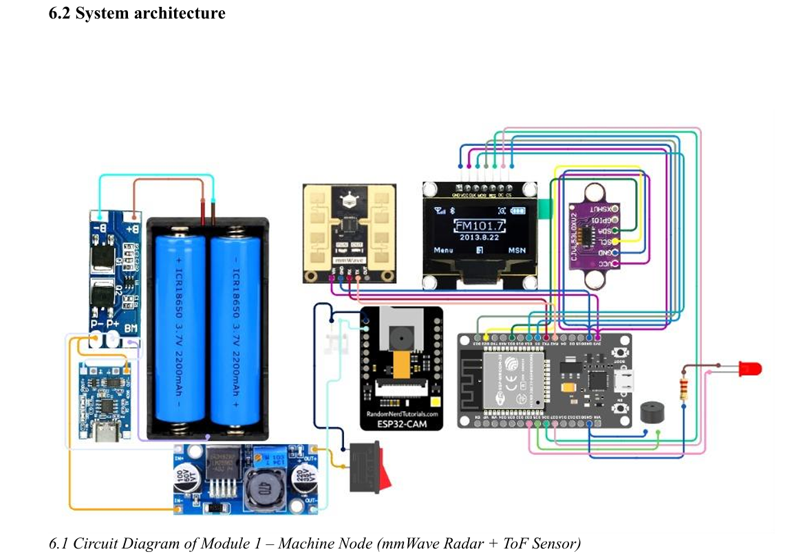
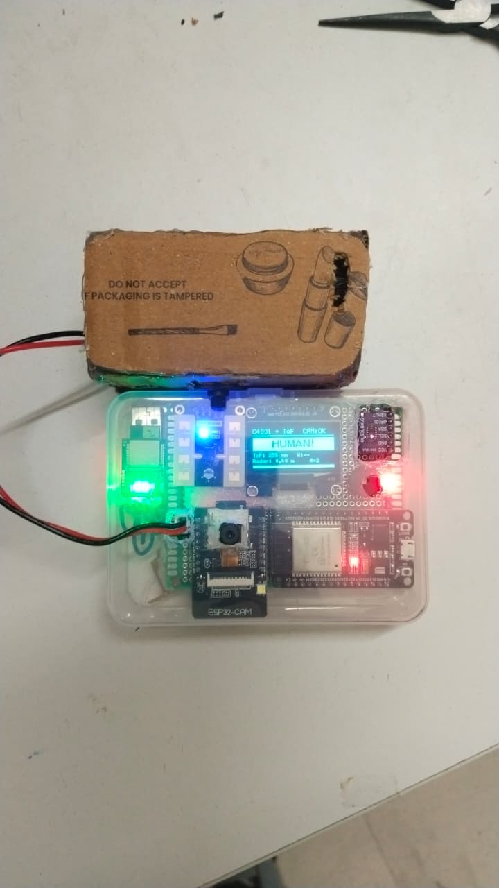
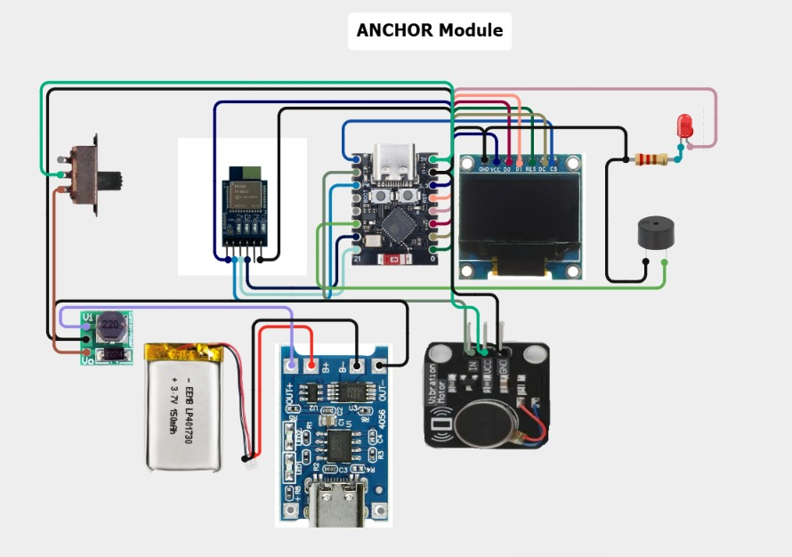
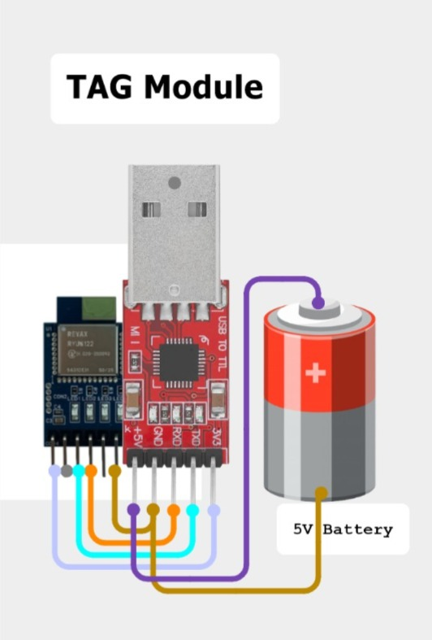
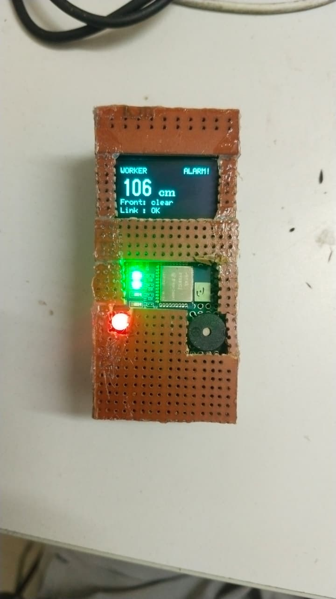

# COLLISION OF MOBILE EQUIPMENT OR 
HIT BY MACHINE IN UG MINES 

A low-cost, battery-powered, **redundant proximity-warning prototype** that alerts both the machine side and the worker side when a person or obstacle comes within a hazardous distance of a mining machine.

> **TEXMiN – Centre of Excellence**, National Institute of Technology Agartala (funded by TEXMiN, IIT (ISM) Dhanbad)
> Project: *Collision of Mobile Equipment or Hit by Machine in UG Mines*


---

## Table of Contents

- [Overview](#overview)
- [Key Features](#key-features)
- [System Architecture](#system-architecture)
- [Hardware](#hardware)
- [Alarm Logic](#alarm-logic)
- [Wireless Protocol (ESP-NOW)](#wireless-protocol-esp-now)
- [Configuration Values](#configuration-values)
- [Power Budget](#power-budget)
- [Project Status](#project-status)
- [Limitations](#limitations)
- [Test Protocol](#test-protocol)
- [Getting Started](#getting-started)
- [Repository Structure](#repository-structure)
- [Future Work](#future-work)
- [Team](#team)
- [References](#references)

---

## Overview

Large mining vehicles (LHDs, dumpers, haul trucks) have serious blind spots, especially at the rear and sides. In an underground mine, dust, darkness and narrow tunnels make it easy for a worker to be invisible to the operator. MSHA found that proximity detection could have prevented 42 fatalities involving coal haulage machines and scoops between 1984 and 2014.

This project builds a **two-path warning system** where either path alone can raise the alarm:

1. **The machine's "own eyes"** – a 24 GHz mmWave radar and a time-of-flight laser sensor detect people and obstacles in front of the machine. An alert triggers a local alarm, a camera snapshot, and a wireless message to the worker.
2. **A pair of UWB radio tags** – a worker wears a UWB anchor and the machine carries a UWB tag. Two-way ranging measures the distance between them. When it gets too small, the worker's unit alarms and tells the machine.

The radar can detect a person who is **not** wearing a tag; the tag can "see" a worker around a corner where the radar has no line of sight.

## Key Features

- Human detection (including near-stationary people) using the **DFRobot C4001 24 GHz mmWave radar**
- Obstacle detection using the **VL53L0X ToF laser sensor**
- Local buzzer + LED alarm that switches on **before any radio work**, so it works even if every wireless link fails
- OLED status display showing only essential information (alert/clear, human/object, distances, link status)
- Photo capture (not video) on every alert via **ESP32-CAM** + SD card (VGA JPEG saved as `alert_1.jpg`, `alert_2.jpg`, … so a restart never overwrites old photos), with a 1 Hz heartbeat to the machine node
- **UWB ranging** (Reyax RYUW122) between worker and machine with median filter, hysteresis and confirmation logic
- Router-free **ESP-NOW** communication between all nodes
- Redundancy by design: failure of one sensor, one radio link or one node does not silence the other path
- Rechargeable battery operation with a documented power budget


## System Architecture

The following diagram illustrates the overall system
architecture of the Collision Avoidance System.

<p align="center">
  
</p>

<p align="center">
  <em>Figure 1: System Architecture</em>
</p>

### Machine Node

The Machine Node monitors the surrounding environment
and provides collision warnings.

<p align="center">
  
</p>

<p align="center">
  <em>Figure 2: Machine Node Hardware</em>
</p>

### Anchor Module

The Anchor Module supports UWB-based distance
measurement between the worker and machine.

<p align="center">
  
</p>

<p align="center">
  <em>Figure 3: Anchor Module Circuit Diagram</em>
</p>

### Tag Module

The Tag Module communicates with the Anchor Module
for distance measurement.

<p align="center">
  
</p>

<p align="center">
  <em>Figure 4: Tag Module Circuit Diagram</em>
</p>

### Hardware Implementation of Tag Module

The following image shows the physical hardware
implementation of the Tag Module.

<p align="center">
  
</p>

<p align="center">
  <em>Figure 5: Hardware Implementation of Tag Module</em>
</p>
  

### Key design decisions

| Decision | Reason |
|---|---|
| Two independent detection paths | Radar sees people without tags; tags see workers outside radar line of sight |
| Local alarm before any radio work | Buzzer/LED cannot be delayed by the wireless link |
| ESP-NOW broadcast on a fixed channel (Wi-Fi ch. 1) | No router, no pairing, no MAC addresses to enter; a magic first byte identifies project packets |
| Each node sends only its own detection | Prevents the two nodes from keeping each other's alarm latched |
| Repeated status packets (100–200 ms) | Broadcast has no ACK; a lost packet is replaced by the next one |
| Median filter + hysteresis + confirmation on UWB | UWB readings scatter; avoids alarm flicker at the threshold |
| Camera snapshots only on alert | Saves power; every alert leaves a record |

## Hardware

### Components

| Component | Qty | Used in |
|---|---|---|
| ESP32 DevKit / WROVER | 1 | Machine node |
| ESP32-C3 Super Mini | 1 | Worker node |
| ESP32-CAM (AI-Thinker) + microSD | 1 | Camera node |
| DFRobot C4001 mmWave radar | 1 | Machine node |
| VL53L0X laser distance sensor | 1 | Machine node |
| Reyax RYUW122 Lite UWB module | 2 | Worker (anchor) and machine side (tag) |
| 1.3" SPI OLED (SH1106) | 2 | Machine and worker nodes |
| Active buzzer module | 2 | Machine and worker nodes |
| Red LED + resistor | 2 | Machine and worker nodes |
| Vibration motor module | 1 | Worker node |
| 18650 Li-ion cell, TP4056 charger, 3.7 V→5 V boost converter | 1 set | Machine power |
| LiPo battery, TP4056, 3.7 V→5 V boost converter | 1 set | Worker power |
| FTDI USB-to-serial adapter | 1 | Programming the ESP32-CAM |
| USB-to-TTL converter | 1 | Configuring the UWB modules |

### Pin assignments

**Machine node (ESP32)**

| Part | Pin(s) |
|---|---|
| C4001 radar TX / RX | GPIO16 (RX2) / GPIO17 (TX2) – UART, 9600 baud |
| VL53L0X SDA / SCL / XSHUT | GPIO21 / GPIO22 / GPIO23 |
| OLED CLK / MOSI / CS / DC / RES | GPIO18 / GPIO19 / GPIO27 / GPIO26 / GPIO25 |
| Buzzer / LED | GPIO14 / GPIO33 |

**Worker node (ESP32-C3 Super Mini)**

| Part | Pin(s) |
|---|---|
| UWB TXD→ESP RX / UWB RXD←ESP TX | GPIO20 / GPIO21 (UART1, 115200 baud) |
| UWB NRST | GPIO7 |
| OLED SCK / SDA / RES / DC / CS (software SPI) | GPIO2 / GPIO4 / GPIO0 / GPIO1 / GPIO5 |
| Buzzer / LED / vibration motor | GPIO6 / GPIO3 / GPIO10 |

**Camera node (ESP32-CAM)** – camera, SD slot and red LED (GPIO33, active low) are on-board; only 5 V, GND and a 470–1000 µF supply capacitor are wired externally. SD runs in 1-bit mode to keep the flash LED pin free.

## Alarm Logic

| Node | Buzzer and LED turn on when |
|---|---|
| **Machine** | Radar sees a person within 1.5 m, **or** laser sees an obstacle within 1.5 m, **or** the worker unit reports the worker is inside the UWB alarm distance. Alarm holds for 2 s after the last detection. |
| **Worker** | UWB distance is below the alarm distance (with hysteresis), **or** the machine reports a human/obstacle in front. |

**Behaviour under failure (design intent – to be verified in field testing):**

| What fails | Expected behaviour |
|---|---|
| Camera node off/broken | Local alarms keep working; machine OLED shows `CAM:--` |
| ESP-NOW link lost | Each node alarms from its own sensors; OLEDs show link `LOST` |
| UWB tag/anchor not answering | Worker unit shows no signal; radar and laser still alarm and tell the worker |
| Radar fails to start | OLED reports it and the program waits – a missing safety sensor is never hidden |
| Laser sensor missing | Radar continues to work |
| One ESP-NOW packet lost | Next status packet arrives within 100–200 ms |
| Worker unit switched off | Machine still alarms from its own radar and laser |

### UWB filtering

1. **Median of last 5 readings** – rejects isolated spikes
2. **Hysteresis** – alarm ON below 150 cm, OFF above 170 cm
3. **Confirmation** – 2 consecutive readings under the limit before alarming
4. Tag silent for 5 consecutive polls → "no signal" and history reset

## Wireless Protocol (ESP-NOW)

All nodes use **Wi-Fi channel 1**. Link is declared lost after 2 s without a message.

**Machine → Camera & Worker (10 bytes, magic `0xA5`)**

| Field | Bytes | Meaning |
|---|---|---|
| magic | 1 | `0xA5` |
| type | 1 | 1 = sensor node, 2 = camera node |
| alert | 1 | 1 when the machine's own alert is active |
| flags | 1 | Sensor: bit0 human (radar), bit1 obstacle (laser). Camera: bit0 camera OK, bit1 SD OK |
| value | 2 | Sensor: laser distance in mm (65535 = none). Camera: photos saved |
| seq | 4 | Message counter |

**Worker → Machine (7 bytes, magic `0xA7`)**

| Field | Bytes | Meaning |
|---|---|---|
| magic | 1 | `0xA7` |
| type | 1 | 2 |
| seq | 1 | Message counter |
| uwbOk | 1 | 1 when a fresh UWB distance exists |
| distCm | 2 | UWB distance in cm (65535 = none) |
| hazard | 1 | 1 when the worker is inside the UWB alarm distance |

The worker packet uses a different magic byte and length, so the camera node safely ignores it.

## Configuration Values

| Setting | Value |
|---|---|
| Radar mode / window | Speed mode, 30–300 cm, threshold 10, fretting detection ON |
| Radar alert distance | ≤ 150 cm |
| Laser alert distance | < 1500 mm, read every 100 ms (long-range mode) |
| Machine alarm hold time | 2000 ms |
| UWB alarm on / off | 150 cm / 170 cm, 2 consecutive readings |
| UWB distance filter | Median of last 5 |
| UWB lost after | 5 failed polls |
| Machine status message | Every 100 ms, or immediately on change |
| Worker status message | Every 200 ms |
| Camera heartbeat / link timeout / photo cooldown | 1000 ms / 1000 ms / 3000 ms |
| UWB network ID / addresses | `REYAX123` / `ANCHOR01` and `TAG00001` |

### UWB module AT commands

| Purpose | Command |
|---|---|
| Set role (1 = anchor, 0 = tag) | `AT+MODE=1` / `AT+MODE=0` |
| Set network ID (8 chars) | `AT+NETWORKID=REYAX123` |
| Set address (**exactly 8 chars**) | `AT+ADDRESS=ANCHOR01` / `AT+ADDRESS=TAG00001` |
| Read settings back | `AT+MODE?`, `AT+NETWORKID?`, `AT+ADDRESS?`, `AT+CPIN?` |
| Measure distance to tag | `AT+ANCHOR_SEND=TAG00001,4,PING` |
| Reply | `+ANCHOR_RCV=TAG00001,length,payload,distance cm` |

> Commands must end with CR+LF. Addresses shorter than 8 characters (e.g. `ANCHOR1`) make ranging fail silently.

## Power Budget

> These are **design estimates from datasheet typical values**, not measurements. Real runtime should be measured and this table updated.

**Machine node (5 V rail):** ≈ 400 mA typical / 740 mA peak (≈ 2.0 W / 3.7 W). With 85 % boost efficiency from a 3.7 V cell, a single 2200 mAh 18650 gives roughly **3.2 h typical / 1.7 h worst case**. Two cells in parallel double this.

**Worker node (5 V rail):**

| Load | Tracking | Alarm active | Peak |
|---|---|---|---|
| Total current | 180 mA | 278 mA | 662 mA |

| LiPo capacity | Tracking only | Alarm always on | Mixed (90/10) | All loads at peak |
|---|---|---|---|---|
| 1000 mAh | 2.8 h | 1.8 h | 2.7 h | 0.8 h |
| 2000 mAh | 5.6 h | 3.6 h | 5.3 h | 1.5 h |
| 3000 mAh | 8.4 h | 5.4 h | 8.0 h | 2.3 h |

A full 8-hour shift needs roughly a **3000 mAh** LiPo. Component notes: TP4056 default charge current is 1 A (suits ≥ 1000 mAh cells); boost converter should deliver ≥ 0.7 A at 5 V and accept > 1.1 A input; power switch rated ≥ 2 A in the battery positive line.

## Project Status

| Subsystem | Status |
|---|---|
| Radar human detection | ✅ Working on the bench |
| Laser obstacle detection | ✅ Implemented in validated sketch |
| OLED status display | ✅ Working on both nodes |
| Local alarm (buzzer + LED) | ✅ Working on both nodes |
| Camera node (snapshot + heartbeat) | ✅ Implemented and used with the machine node |
| UWB ranging | ✅ Working (readings scatter more than datasheet figure) |
| UWB filtering and alarm | ✅ Working on the worker unit |
| Vibration motor | ✅ Working|
| Two-way machine ↔ worker link | 🟡 Firmware written; integrated field test pending |

## Limitations

- The system **warns only** – it cannot slow or stop the machine.
- **1.5 m is a bench value.** A truck at 20 km/h covers ≈ 5.6 m/s; with a 1.5 s reaction time it travels ≈ 8.3 m before braking starts. Thresholds are adjustable parameters and should be increased (ideally speed-dependent) for real vehicles. This is a simple calculation, not a measured stopping distance.
- UWB scatter is higher than the datasheet's ~10 cm open-field figure (reflections, body blocking the antenna, antenna alignment, nearby electronics, uncalibrated offset).
- Radar is more sensitive to radial than lateral motion and cannot tell a person from another moving object.
- VL53L0X is reliable only to ~1.2 m and is affected by bright sunlight, reflective and transparent surfaces.
- ESP-NOW broadcast is **unacknowledged and unencrypted** – spoofed packets could cause or suppress an alarm.
- No night lighting for the camera; dark scenes give dark photos. The camera records but does not identify people.
- Radio range is untested underground, around corners or through rock.
- Enclosures, batteries and electronics are not rated for hazardous atmospheres.

## Test Protocol

Planned integrated field tests (observed column intentionally empty until measured):

| No. | Test | What to record |
|---|---|---|
| T1 | Radar alarm distance (person walks toward machine) | Alarm-start distance, 5 repetitions |
| T2 | Laser alarm (flat object moved toward sensor) | Alarm-start distance |
| T3 | UWB accuracy at 50, 100, 150, 200, 300 cm | 100 readings each; mean and spread |
| T4 | UWB alarm (worker walks toward machine) | Alarm start/end vs. 150/170 cm settings |
| T5 | ESP-NOW range and loss | Max distance with `CAM:OK` and link OK; packets lost |
| T6 | Camera triggered by alert | Photo on SD, delay from alarm |
| T7 | Redundancy (switch off worker unit, tag, camera node in turn) | Does each remaining path still alarm? |
| T8 | Battery run time | Hours to shutdown vs. 3.2 h estimate |

## Getting Started

### Requirements

- **Arduino IDE** with the **ESP32 board package** (the ESP-NOW receive callback signature differs between older and newer cores; the code selects the correct form at compile time)
- Libraries: `DFRobot_C4001`, `Adafruit_VL53L0X`, `U8g2`, `esp_now`, `esp_wifi`, `esp_camera`, `SD_MMC`

### Steps

1. **Wire the nodes** using the pin tables above.
2. **Configure the UWB modules** (via USB-to-TTL converter, or an ESP32 as a transparent serial bridge): set one module to anchor (`MODE=1`, `ANCHOR01`) and one to tag (`MODE=0`, `TAG00001`) with the same network ID and password. Read the settings back to confirm.
3. **Flash the firmware** to each board:
   - `machine_node` → ESP32 DevKit
   - `worker_node` → ESP32-C3 Super Mini
   - `cam_node` → ESP32-CAM (use the FTDI adapter)
4. Power each node, confirm the machine OLED shows `CAM:OK`, and walk toward the machine to verify the alarms.

> **Tip from the build:** do not rewrite validated code without good reason. A replacement radar routine behaved differently from the validated one and had to be rolled back.

## Repository Structure

> Adjust to match your actual folders.

```
.
├── README.md
├── firmware/
│   ├── machine_node/      # ESP32: radar, laser, OLED, alarm, worker link
│   ├── worker_node/       # ESP32-C3: UWB ranging, filtering, display, alarm
│   └── cam_node/          # ESP32-CAM: snapshot on alert + heartbeat
├── hardware/
│   ├── circuit-diagrams/  # Machine node, UWB tag, worker (anchor) node
│   └── bill-of-materials/
├── docs/
│   └── Texmin_final_report.pdf
└── images/                # Prototype photos
```

## Future Work

1. Run the field tests and record real UWB error and ESP-NOW range
2. Calibrate UWB and study antenna placement (wrist and machine)
3. Increase warning distances based on real stopping distance; make them speed-dependent
4. Interface with machine controls (e.g., relay to cut traction or sound an in-cab alarm)
5. Support multiple workers with unique tag addresses
6. Secure ESP-NOW (unicast, encryption/authentication, acknowledgements)
7. Add IR illumination or a thermal sensor for dark/dusty conditions
8. Fix or replace the vibration motor (test with input tied to 5 V/GND; try a transistor driver)
9. Add battery monitoring and low-battery warnings; measure real consumption
10. Rugged enclosure designed for hazardous-atmosphere requirements
11. Measure underground radio range; consider LoRa if insufficient
12. Check the design against DGMS (India) and MSHA (US) requirements

## Project Supervisor

Dr. Yogesh Kumar Sariya – Dept. of Electronics and Instrumentation Engineering, NIT Agartala

**Branch** (B.Tech, Electronics and Instrumentation Engineering):

 **Project Contributor** Manjesh Kumar


**Acknowledgements:** Faculty In-charge TEXMiN Dr. Rajib Saha (Civil Engineering) and CIC Ms. Sushmita Roy, NIT Agartala; and the open-source community and manufacturers (DFRobot, STMicroelectronics, Espressif, Reyax, U8g2 and Adafruit developers).

## References

1. Bissert, DuCarme, Noll and Jobes (NIOSH), "Alternate technologies applicable to proximity detection on mobile machines in underground coal mines," SME, 2017. <https://stacks.cdc.gov/view/cdc/228423>
2. Carr, DeGennaro, Whisner, Yonkey and Zhou (NIOSH), "Evaluation of alternative technologies for underground mining proximity detection systems," SME, 2020. <https://stacks.cdc.gov/view/cdc/215265>
3. Directorate General of Mines Safety (India), "Safety Alert 01: Fatal accident at Jayant Opencast Project," 12 March 2026. <https://www.dgms.gov.in/writereaddata/UploadFile/01_Safetyalert_Jayant_12032026.pdf>
4. Directorate General of Mines Safety (India), "Accident alert: Ramagundam Opencast Mine III, Signorini Collieries," 23 June 2017. <https://dgms.gov.in/writereaddata/UploadFile/Alert_Ramagundam%20OC%20Mine%20-%20III_SCCL_23-06-2017.pdf>
5. Directorate General of Mines Safety (India), "Serious accident alert: Prakasham Khani Opencast Mine, Singareni Collieries," 18 January 2018. <https://www.dgms.gov.in/writereaddata/UploadFile/SA_Alert_PKOC_SCCL_18-01-2018.pdf>
6. Mobility Outlook Bureau, "Hi-Tech Group unveils DGMS-compliant safety solutions for Eicher mining trucks at Bharat Mobility Global Expo 2025," 18 January 2025. <https://www.mobilityoutlook.com/news/hi-tech-group-unveils-dgms-compliant-safety-solutions-for-eicher-mining-trucks-at-bharat-mobility-global-expo-2025/>
7. IEEE Technology Navigator, "Ultra-wide bandwidth." <https://technav.ieee.org/topic/ultra-wide-bandwidth/>
8. U.S. Department of Labor, Mine Safety and Health Administration, "MSHA announces public hearings on proposed rule for proximity detection systems on mobile mine machines," News release, October 2015. <https://www.dol.gov/newsroom/releases/msha/msha20151001>
9. Safety Health magazine, "Proposed rule would require proximity detection on underground coal-haulage equipment." <https://www.safetyandhealthmagazine.com/articles/12917-proposed-rule-would-require-proximity-detection-on-underground-coal-haulage-equipment>
10. NIOSH, "Advances in proximity detection technologies for surface mining equipment." <https://stacks.cdc.gov/view/cdc/902941>

